# Architecture

This document describes how the integration is built. The diagrams are kept in sync with the code; each
section names the issue that introduced it. Design rationale lives in [`design/`](design/).

## 1. Overview

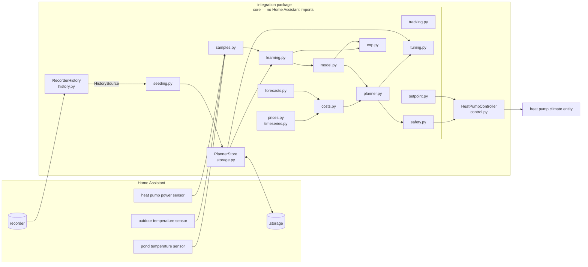

The integration is split in two layers:

- **`core/`** holds all computation. It is plain Python + numpy, tested on its own:
  - samples;
  - the thermal model;
  - learning;
  - seeding;
  - prediction tracking;
  - later the planner.
- **The integration package** connects the core to Home Assistant: state listeners, storage, the recorder,
  entities and services.

## 2. Design principles

| Principle / pattern | Where | Why |
|---|---|---|
| Single responsibility | one concern per module: model (`model.py`), learning (`learning.py`), seeding (`seeding.py`), tracking (`tracking.py`), persistence (`storage.py`), recorder access (`history.py`) | each part changes for one reason and is tested alone |
| Open/closed + **Strategy** | `Fitter` protocol with `SlowFit`, `CoolingFit` | a new fit (e.g. solar gain) is a new class, existing fits stay untouched |
| **Facade** | `Learner` runs the fits in order | the rest of the integration calls one method |
| Dependency inversion + **Adapter** | `seeding.seed()` depends on the `HistorySource` protocol; `RecorderHistory` adapts the recorder | the core never imports Home Assistant and is tested with a fake source |
| **Repository** | `PlannerStore` | one place that loads and saves samples and parameters |
| Liskov / immutability | fits return new `ModelParams` (via `copy()`), never mutate their input | fits can be chained and compared safely |
| Interface segregation | small protocols (`Fitter.fit`, `HistorySource.series`, `Planner.make_plan`, `AttributeParser.parse`) | implementations need only what they use |
| **Strategy** + **Chain of responsibility** | `AttributeParser` implementations (`DictListParser`, `PlainListParser`) tried in turn by `parse_intervals` | a new price format is a new parser; the planner never sees attribute formats |
| Open/closed + **Strategy** | `Planner` protocol, `DynamicProgrammingPlanner` | another optimiser can replace it without touching callers (the tuning takes any `Planner`) |
| **Strategy** | `SetpointStrategy` protocol, `OffsetSetpoint` | another heat pump can be controlled differently without touching the controller |
| Single responsibility | `SafetyGuard` decides, `OffsetSetpoint` translates, `HeatPumpController` sends and watches | decisions are tested without Home Assistant |
| Separation of cost and optimisation | `EnergyCosts` computes € per quarter and mode (solar surplus, feed-in, surcharge); the planner only minimises | solar, feed-in and surcharge change no planner code |

## 3. Thermal model and learning (#2)

### 3.1 Classes

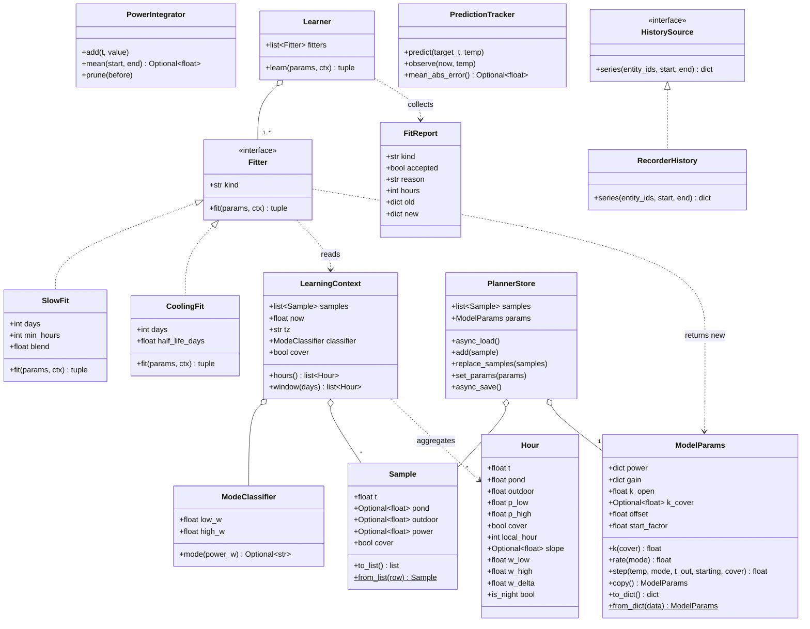

Module functions: `samples.to_quarters`, `prune`, `merge` (built on `PowerIntegrator`); `learning.hourly`;
`seeding.seed` (uses a `HistorySource`); `history.async_seed_store` (runs `seed` in the recorder executor).

### 3.2 Model step

One quarter hour (Δt = 0.25 h):

```
T' = T + Δt · (gain[m] · s · power[m] − k(cover) · (T − T_out) + offset)
```

`s` is `start_factor` in the first quarter after the heat pump was off, otherwise 1.

### 3.3 Seeding on first start

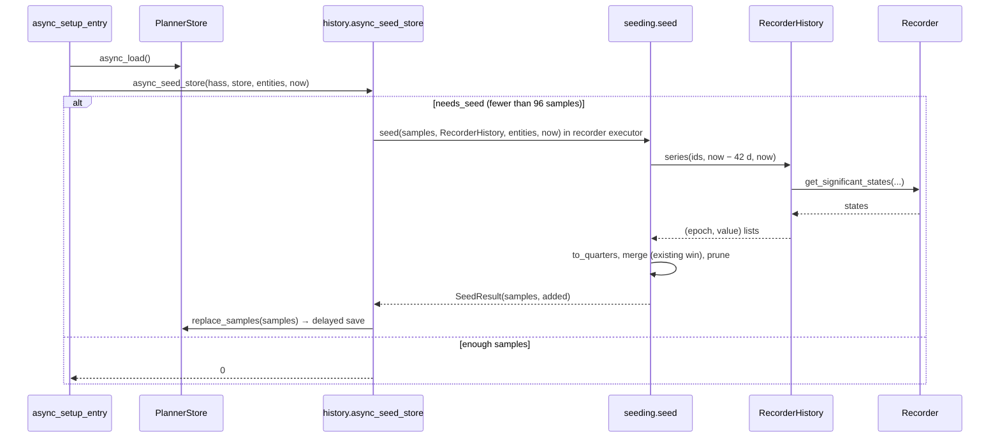

### 3.4 Nightly learning

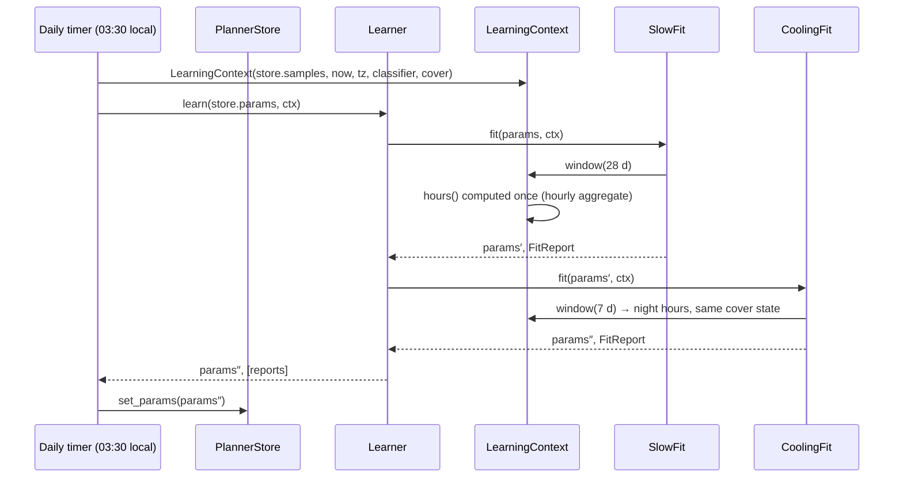

The timer and the wiring to the entities are added with the coordinator (#4, #5).

### 3.5 Hourly aggregation and slope window

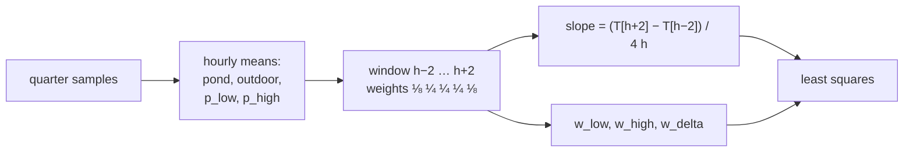

The slope and the regressors cover the same interval. With only the middle hour as regressor, the gains
come out ~30 % too low (errors in variables). See the design of #2, §2.

## 4. Planner (#3)

### 4.1 Classes

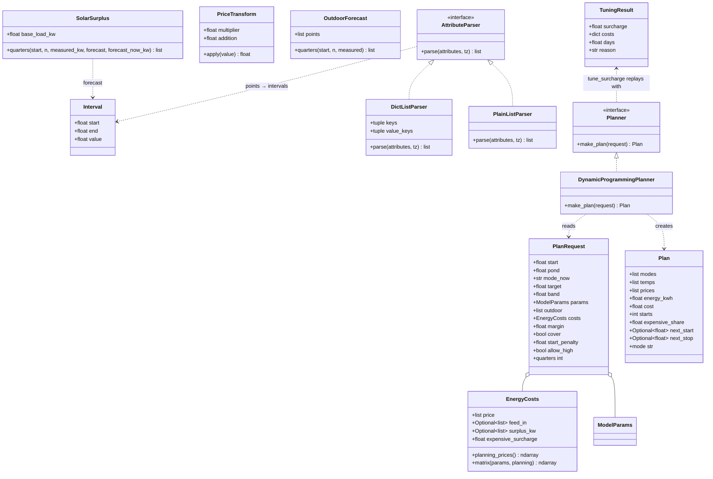

Module functions: `parse_intervals` (tries the parsers in turn), `quarter_values`, `close_intervals`,
`solar_intervals`, `surplus_now`, `summarize`, `tune_surcharge`.

### 4.2 Planning cycle (core part)

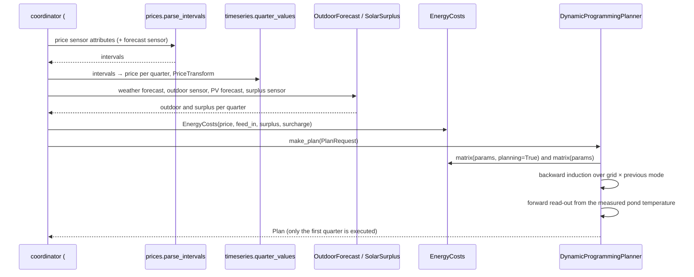

### 4.3 Dynamic programming

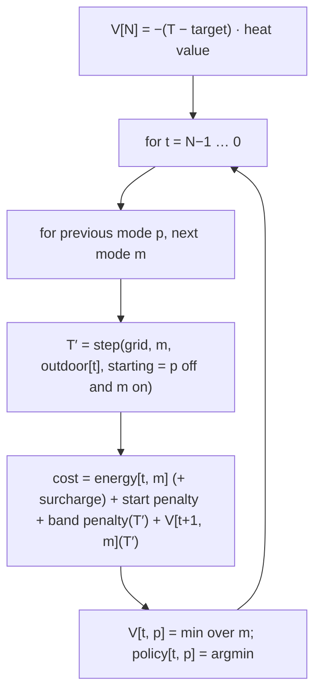

### 4.4 Nightly surcharge tuning

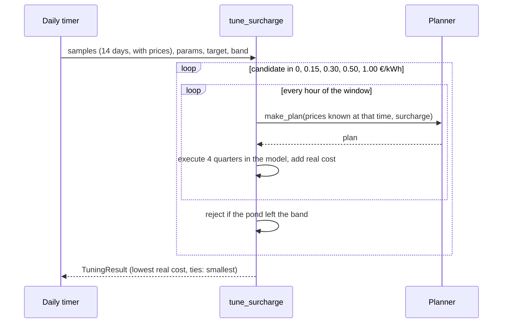

## 5. COP, heat loss and thermal power (#8)

Formulas: [`cop.md`](cop.md).

### 5.1 Classes

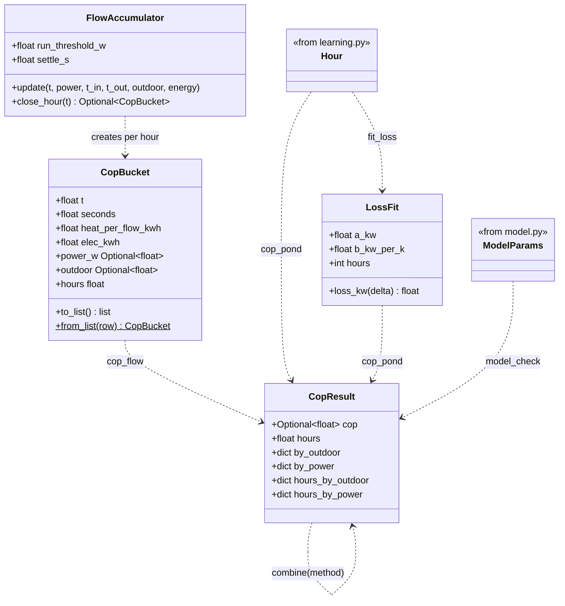

Module functions: `capacity_kwh_per_k`, `heat_loss_w_per_k`, `thermal_power_w` (from `ModelParams`),
`cop_flow`, `fit_loss`, `cop_pond`, `combine` (flow, pond or average), `model_check`.

### 5.2 Flow method: from state changes to COP

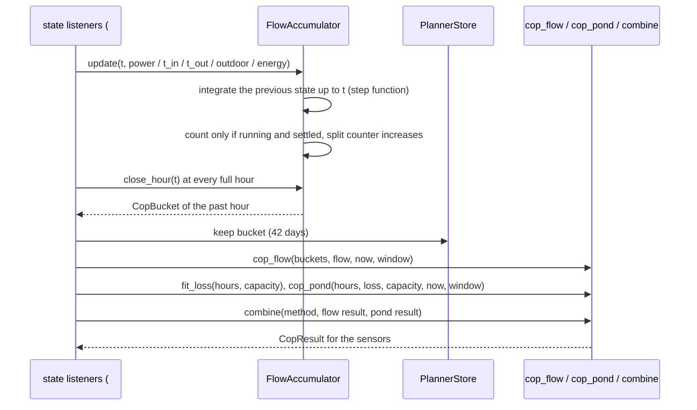

### 5.3 Counting state of the flow method

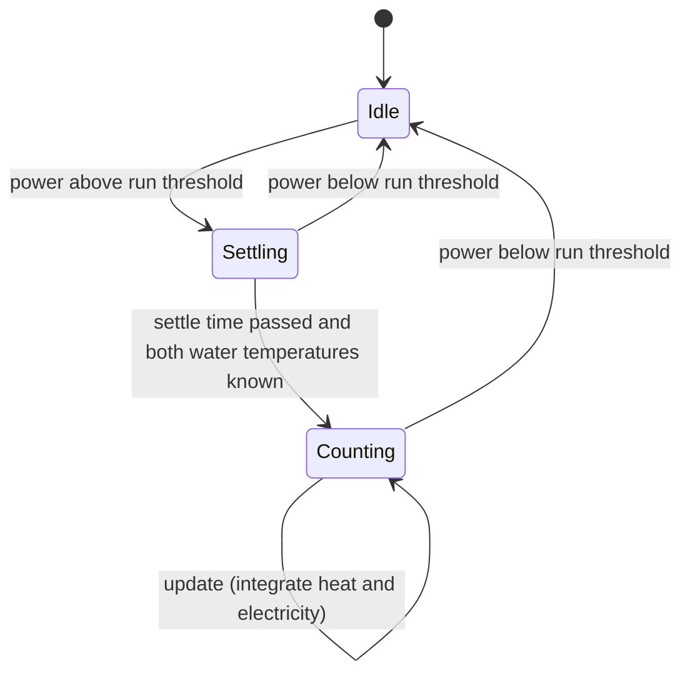

## 6. Control and safety (#4)

Design: [`design/2026-11-17-control-and-safety.md`](design/2026-11-17-control-and-safety.md).

### 6.1 Classes

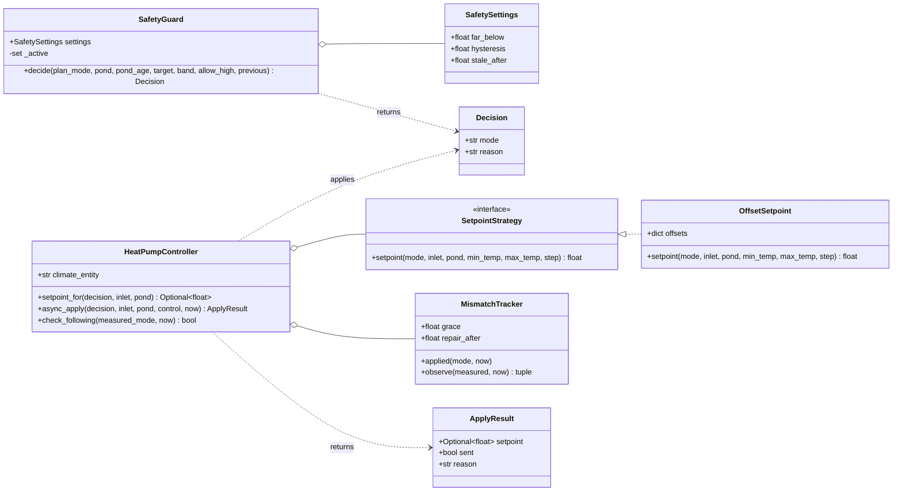

### 6.2 Safety rules

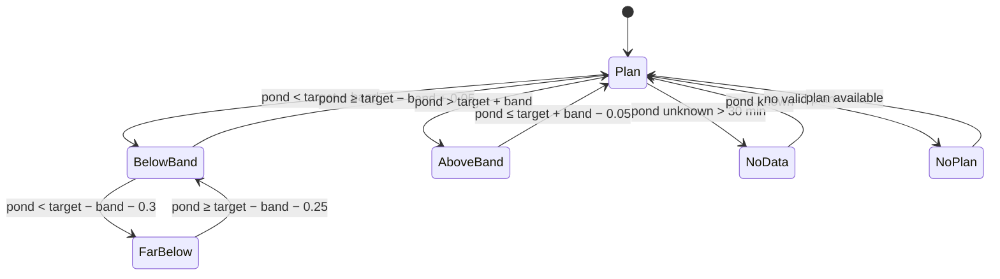

### 6.3 Applying a decision

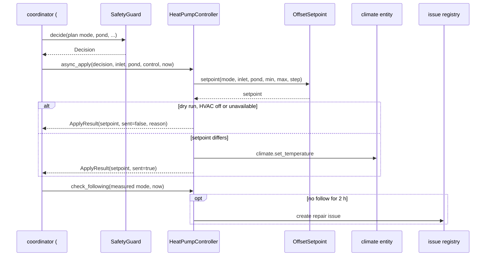
