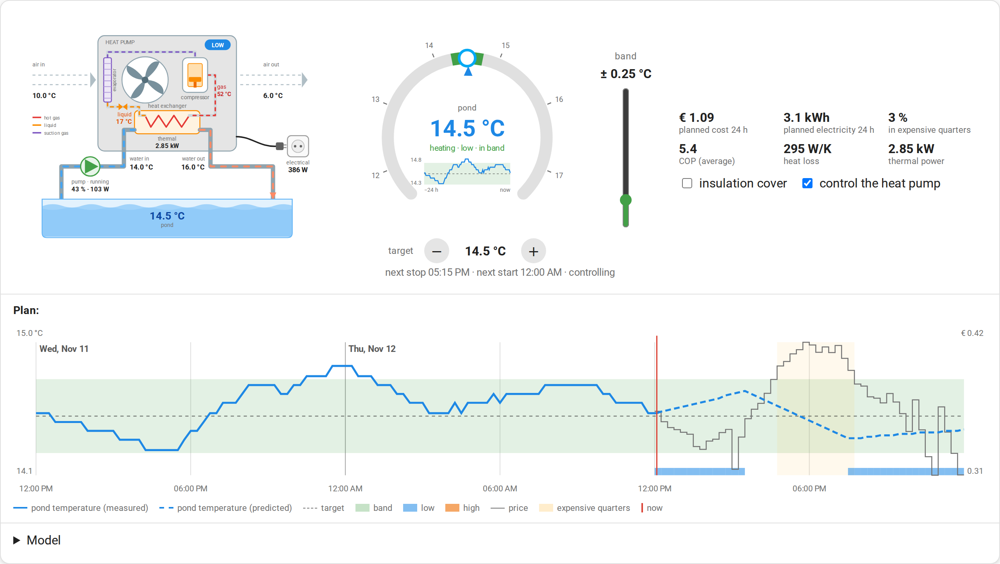
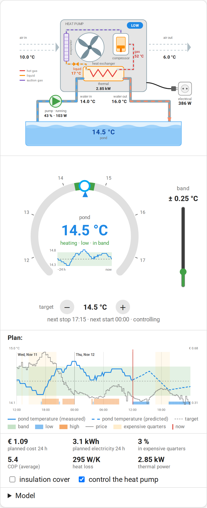
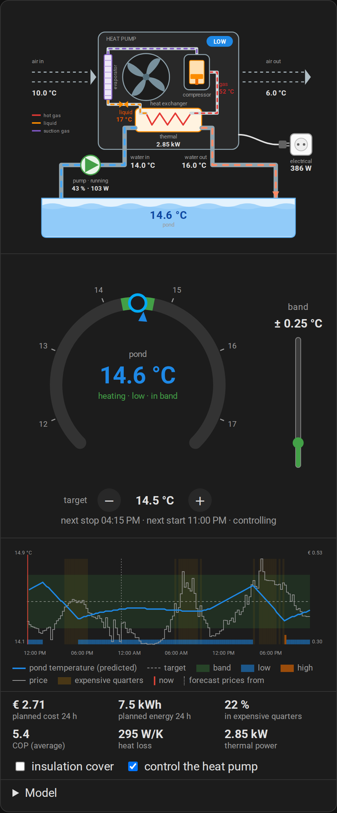
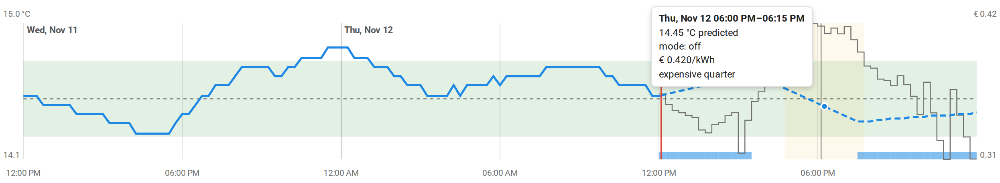

# Lovelace card

The integration ships its own dashboard card. It shows the heat pump as an animated drawing, a thermostat
with the band, the plan and the key figures, and lets you change the target, the band and the switches.



| One column, light theme | One column, dark theme |
|---|---|
|  |  |

The screenshots are made from the real card with example data (`python scripts/screenshot_card.py`).

## Adding the card

The card is loaded automatically with the integration; there is no separate download and no dashboard
resource to add.

1. Open a dashboard, choose *Edit dashboard → Add card*.
2. Search for **Pond Heat Pump Planner**.
3. Choose the planner device. The card is ready; the other settings are optional.

After an update of the integration, reload the browser page once if the card does not change.

## Size and layout

The card adapts its layout to its own width:

| Card width | Layout |
|---|---|
| narrow (one dashboard column) | everything stacked |
| about two columns (560 px and more) | heat pump and thermostat side by side; the plan over the full width; figures with switches next to the model |
| three columns or more (900 px and more) | heat pump, thermostat and figures with switches side by side; plan and model over the full width |

**Making it wider:**
- **Sections dashboard:** the card fills its section by default. To make it 2, 3 or more dashboard columns
  wide, make the section wider (*Edit section → column span*); the card follows. You can also make the card
  narrower within its section, down to half a section.
- **Masonry dashboard:** the card takes the width of its column.
- **Panel view:** the card takes the full width of the screen.

## What it shows

| Section | Contents |
|---|---|
| Heat pump | The drawing below, with live values and animations |
| Thermostat | Ring with the pond temperature (triangle), the target (handle, drag it) and the band (green); target − / + and a vertical slider for the band (in °C); next start/stop and whether the planner controls the heat pump |
| Plan | 24, 36 or 48 hours, ending where the known prices end (see below): measured pond temperature up to now (solid line), predicted pond temperature from now (dashed line), with band (shaded) and target (dashed), mode per quarter (bars: blue low, orange high, red boost; lighter before now, where they show the measured mode), price (thin step line), expensive quarters (light background), solar quarters (yellow), now (red line) and where forecast prices begin (dotted); a legend below the chart explains each element |
| Figures | Planned cost and energy for 24 h, share in expensive quarters, COP (method), heat loss, thermal power |
| Switches | Insulation cover, control the heat pump |
| Model | Collapsible: cooling coefficient, heating rates (boost only when configured), prediction error, last learned, COP by outdoor temperature |

Changes to the target and the band are sent one second after the last change, so quick presses become one
update.

### The plan chart

The right side of the chart is where the plan ends: the last known price (or the last forecast price, with a
price forecast sensor). The left side is that moment minus `hours`. Between the left side and now the chart
shows what happened: the measured pond temperature, the measured mode per quarter (lighter bars, from the mean
power of the heat pump), the price and the expensive quarters. From now on the chart shows the plan.

| Time | Prices known until | Chart (`hours: 36`) | Measured | Plan |
|---|---|---|---|---|
| 09:00 | today 24:00 | yesterday 12:00 – today 24:00 | 21 h | 15 h |
| 14:00 (after the day-ahead prices) | tomorrow 24:00 | today 12:00 – tomorrow 24:00 | 2 h | 34 h |

When the plan is longer than `hours`, the chart shows now … now + `hours`.

Point at the chart (or touch it on a phone) for a hairline with the values of that quarter: day and time,
pond temperature (measured or predicted), mode (measured or planned), price (with "forecast" for forecast prices), and whether it is
an expensive quarter or has solar surplus. With the keyboard: focus the chart (Tab), then ← and → move one
quarter, Home and End jump to the start and end, Escape hides the hairline.



The thermostat shows a small chart of the measured pond temperature of the last 24 hours.

### The drawing


| Element | Shows | Moves when |
|---|---|---|
| Pond | pond temperature | the water surface waves gently, always |
| Pump | speed and power; green running, red fault, grey off (running follows the water flow) | – |
| Water pipes | water in and out temperatures | dashes flow while the `flow` entity is on (see below without one) |
| Fan | – | turns while the `fan` entity is on |
| Compressor | – | the piston pumps while the `compressor` entity is on |
| Refrigerant lines | hot gas (red), liquid (orange), suction gas (purple); gas and liquid temperatures | dashes flow while the compressor runs |
| Heat exchanger | thermal power below it | – |
| Power cord and socket | electrical power | – |
| Air arrows | air in and out temperatures | dashes flow while the fan runs |

Without a `fan`, `compressor` or `flow` entity, the drawing follows the planner: these parts run while the
measured mode (from the mean power) is low, high or boost. For the water flow the card first uses the circulation
sensor linked in the integration, if there is one. A configured entity always wins.

With the browser or system setting *reduce motion*, nothing moves; states stay visible as colours and
labels. Values without an entity are left out.

## Options

All options can be set in the visual editor.

```yaml
type: custom:pond-heatpump-planner-card
device_id: 0123456789abcdef   # the planner device
hours: 36                     # width of the plan chart: 24, 36 or 48 hours, ending at the last known price
sections: [heat_pump, thermostat, plan, figures, switches, model]   # order and visibility
language: auto                # auto (follow the integration), en or nl
heat_pump:                    # entities of the drawing, all optional
  water_in: sensor.heat_pump_water_inlet_temperature
  water_out: sensor.heat_pump_water_outlet_temperature
  air_in: sensor.heat_pump_air_inlet_temperature
  air_out: sensor.heat_pump_air_outlet_temperature
  power: sensor.heat_pump_power
  liquid: sensor.heat_pump_condenser_temperature   # refrigerant after the heat exchanger
  gas: sensor.heat_pump_gas_out_temperature
  fan: binary_sensor.heat_pump_fan_active
  flow: binary_sensor.heat_pump_circulation_active
  compressor: binary_sensor.heat_pump_compressor_active
  pump_speed: sensor.circulation_pump_speed
  pump_power: sensor.circulation_pump_power
  pump_fault: binary_sensor.circulation_pump_fault
```

| Option | Default |
|---|---|
| `device_id` | the first planner device |
| `hours` | 36 (for 48, also set the integration's *Planning horizon* to 48 h) |
| `sections` | all, in the order above |
| `language` | `auto`: the [language option](configuration.md#language) of the integration, or your profile language when that is automatic. The language sets the texts, dates (`vr 21 nov`) and numbers (`€ 0,33`); times are always 24-hour |
| `heat_pump.water_in`, `water_out`, `air_in`, `power` | the entities linked in the integration |
| `heat_pump.flow` | the circulation sensor linked in the integration; without it, the measured mode |
| `heat_pump.fan`, `compressor` | the measured mode of the planner (running at low, high or boost) |
| other `heat_pump` keys | none (left out of the drawing) |

## Troubleshooting

| Symptom | Fix |
|---|---|
| "Choose a planner device" | pick the device in the editor |
| Card not in the picker | reload the browser page; check that the integration is loaded |
| A value is missing in the drawing | link the entity in the editor (*Heat pump*) |
| Nothing moves | check the boolean entities in the editor, and the *reduce motion* setting of the device |
