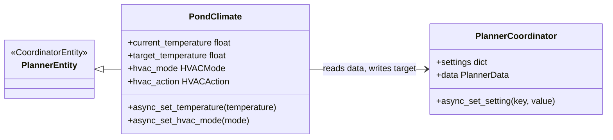

# Climate entity for the target temperature

- Issue: #12
- Status: **approved** (2026-11-17)
- Date: 2026-11-17

## 1. Purpose

Replace the target temperature number entity with a climate entity, so the pond can be shown and set as a
thermostat: in the thermostat card, by voice assistants and through HomeKit.

## 2. Entity

`climate.<name>_thermostat` (translation key `thermostat`, name "Thermostat" / "Thermostaat"), on the planner
device. A stored target above 28 °C (possible with the old number) is shown and planned as 28 °C.

| Property | Value |
|---|---|
| `current_temperature` | measured pond temperature (the linked pond sensor) |
| `target_temperature` | the stored target (`settings.target`) |
| `min_temp` / `max_temp` / `target_temperature_step` | 5 / 28 / 0.1 °C |
| `temperature_unit` | °C |
| `hvac_modes` | `[heat]` |
| `hvac_mode` | `heat` |
| `hvac_action` | `heating` when the applied mode (decision) is low or high, `idle` when off; `None` before the first plan |
| `supported_features` | `TARGET_TEMPERATURE` |
| Extra attributes | `mode`, `reason`, `band`, `control` |

`set_temperature` writes the target through `PlannerCoordinator.async_set_setting(target, …)`, so it replans
like the number did. `set_hvac_mode(heat)` is accepted and does nothing; other modes are not offered.

**Why only heat:** "off" would mix up two things, a heat pump that is switched off and a planner that only
plans. Whether the planner controls the heat pump stays the *Control the heat pump* switch. The heat pump's
own climate entity is where it is switched off.

## 3. Removal of the number entity

- The `target` number description is removed. The stored setting keeps its key, so the value carries over.
- On setup, the integration removes a leftover `number` entity with the unique ID `<entry_id>_target` from
  the entity registry. That way no unavailable entity stays behind. This is the integration's own entity, so
  removing it is safe.
- The changelog notes the change under *Changed*.

## 4. Classes

## 5. Documentation and card

- `docs/entities.md`: `pond` climate instead of `target`; the installation guide and dashboard examples
  likewise. `PlannerData` gets the measured pond temperature (it already has `pond`).
- The card design (#10) uses the climate entity in the "now" section and for the target control.

## 6. Tests

Home Assistant tests:
- the climate entity exists with the current and target temperature;
- `climate.set_temperature` changes the stored target and triggers a replan;
- `hvac_action` follows the decision;
- `set_hvac_mode(heat)` is accepted;
- a leftover target number is removed from the registry on setup.

The documentation test keeps every entity key documented.

## 7. Out of scope

Presets, schedules, `hvac_mode` off.
