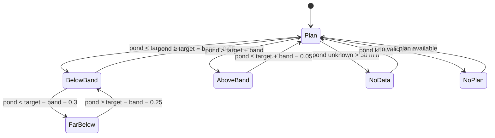
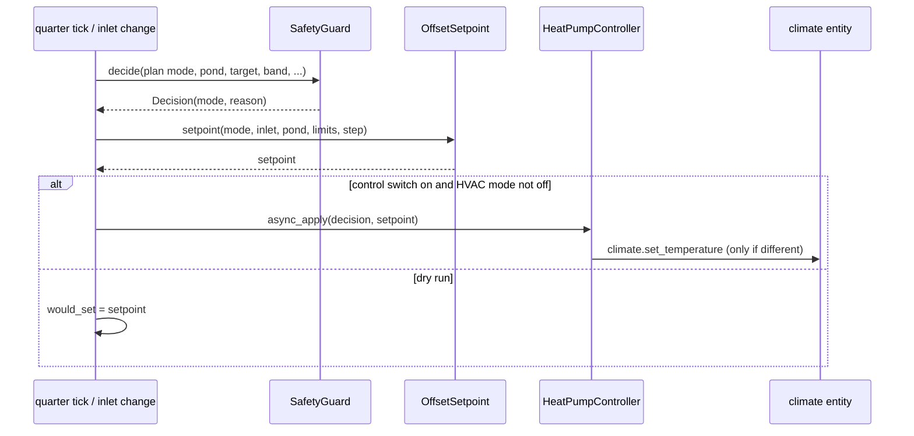

# Heat pump control and safety

- Issue: #4
- Status: **draft**
- Date: 2026-11-17

## 1. Purpose

Turn the planned mode of the current quarter into a setpoint for the heat pump, safely:
- the pond stays healthy when data is missing or the plan is wrong;
- the user can run the planner without control first (dry run);
- the heat pump only receives a command when something changes.

## 2. How the reference heat pump responds

The heat pump has its own thermostat on its water inlet temperature. Setpoint and inlet temperature are
whole degrees. Measured on the reference installation (15-10 to 17-11-2026):

| Setpoint − inlet | Median power | Mode |
|---|---|---|
| ≤ −2 | 5 W | off |
| −1 | 6 or 371 W (alternating) | off/low |
| 0 | 386 W | low |
| +1 | 940 W | high |
| +2 | 895 W | high |

The mode is therefore controlled through the setpoint relative to the inlet temperature. The offsets are
options, so other heat pumps can be configured.

## 3. Decision

Every quarter (and on relevant changes, §5) a pure function decides the mode to apply:

```
decide(plan_mode, pond, target, band, data_ok, plan_ok, allow_high, previous) -> Decision(mode, reason)
```

Rules, in order; the first that applies wins:

| # | Condition | Mode | Reason |
|---|---|---|---|
| 1 | pond temperature unknown for > 30 min | low | `no_pond_temperature` |
| 2 | pond < target − band − 0.3 K | high (low if high is not allowed) | `far_below_band` |
| 3 | pond < target − band | at least low | `below_band` |
| 4 | pond > target + band | off | `above_band` |
| 5 | no valid plan (no prices, error) | low below target, off above target + band/2, else previous | `no_plan` (thermostat) |
| 6 | otherwise | the plan's mode | `plan` |

**Hysteresis.** Rules 2 to 4 release only 0.05 K inside their threshold, so a pond hovering at a limit does
not flip every quarter.

**Rule 3** never lowers the plan: if the plan says high, high stays.

The decision is pure Python in `core/safety.py`, without Home Assistant, and is unit-tested.

## 4. Applying the decision

```
setpoint = clamp(round(inlet) + offset[mode], climate.min_temp, climate.max_temp)
```

| Option | Default |
|---|---|
| Offset off / low / high | −2 / 0 / +1 K |
| Inlet temperature sensor | optional; without it `round(pond)` is used |

- **Rounding.** The setpoint is rounded to the climate entity's `target_temp_step` (1 on the reference
  heat pump).
- **Only changes are sent.** `climate.set_temperature` is called only when the computed setpoint differs
  from the climate entity's current target temperature.
- **When to re-apply.**
  - at every quarter;
  - when the inlet temperature changes (the whole-degree value moves, so "low" needs a new setpoint);
  - when the control switch is turned on;
  - after a Home Assistant start, once the climate entity is available.
- **Climate switched off.** If the climate entity's HVAC mode is `off`, the planner does not switch it on:
  the user switched it off on purpose. The mode sensor reports `heat_pump_off`, and planning continues.
  Setting the HVAC mode is out of scope.
- **Commands are not repeated.** A failed service call is logged and retried at the next quarter.

## 5. Dry run (control switch)

- **Switch off (default after installation):** plan, decide and show everything, but call no service.
  - The mode sensor shows the mode that would be applied.
  - The attribute `would_set` shows the setpoint that would be sent.
  - The existing automations keep working.
- **Switch on:** the decision is applied. Turning it off again leaves the heat pump at its last setpoint;
  the user's own automations take over.
- **Not managed.** The integration does not disable other automations. The installation guide (#6)
  explains which ones to turn off.

## 6. Checking that the heat pump follows

After a mode change, the measured power should match the new mode within 30 minutes (the heat pump may
need time to start). If it does not:
- an attribute `mismatch` with the expected and the measured mode appears;
- after 2 hours of mismatch a Home Assistant repair issue is raised ("heat pump does not follow the
  planner"), and cleared when it follows again.

The planner keeps working; it plans from the measured mode.

## 7. Interfaces

```python
# core/safety.py
@dataclass(frozen=True)
class SafetySettings:
    far_below: float = 0.3
    hysteresis: float = 0.05
    stale_after: float = 1800

@dataclass(frozen=True)
class Decision:
    mode: str
    reason: str

class SafetyGuard:
    def __init__(self, settings: SafetySettings = SafetySettings()) -> None
    def decide(self, *, plan_mode: str | None, pond: float | None, pond_age: float, target: float,
               band: float, allow_high: bool, previous: str) -> Decision

# core/setpoint.py
@dataclass(frozen=True)
class OffsetSetpoint:          # strategy: other heat pumps could get another strategy
    offsets: dict[str, int]    # mode -> K
    def setpoint(self, mode: str, inlet: float | None, pond: float, min_temp: float, max_temp: float,
                 step: float) -> float

# control.py (Home Assistant)
class HeatPumpController:
    async def async_apply(self, decision: Decision) -> ApplyResult   # calls climate.set_temperature if needed
    def mismatch(self, measured_mode: str | None, now: float) -> Mismatch | None
```

`SafetyGuard` keeps the hysteresis state, so it is a class rather than a function.
`OffsetSetpoint` implements a `SetpointStrategy` protocol.

## 8. Diagrams





## 9. Tests

- `SafetyGuard`: every rule, the order of the rules, hysteresis at each limit, stale data, high not
  allowed.
- `OffsetSetpoint`: rounding, clamping to min/max, step 1 and 0.5, missing inlet.
- Controller (with a fake climate state): no call when unchanged, a call when different, no call in dry run
  or when HVAC mode is off, mismatch after 30 min and repair after 2 h.

## 10. Out of scope

Switching circulation pumps or other devices; changing the HVAC mode or preset of the heat pump; detecting
or disabling the user's own automations.
