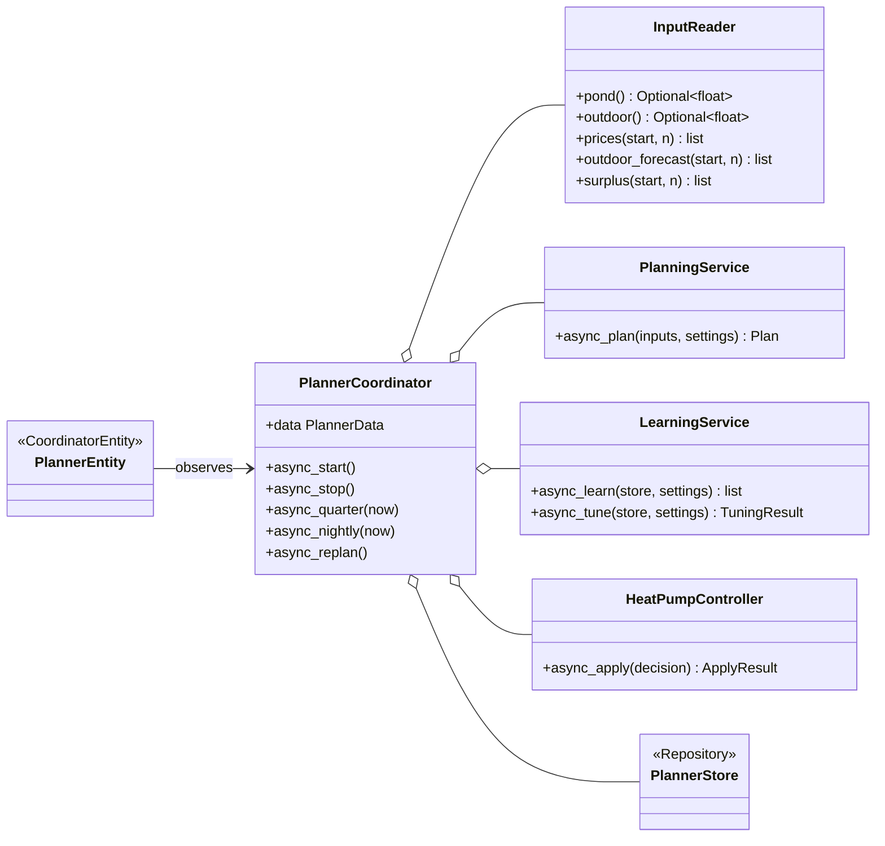
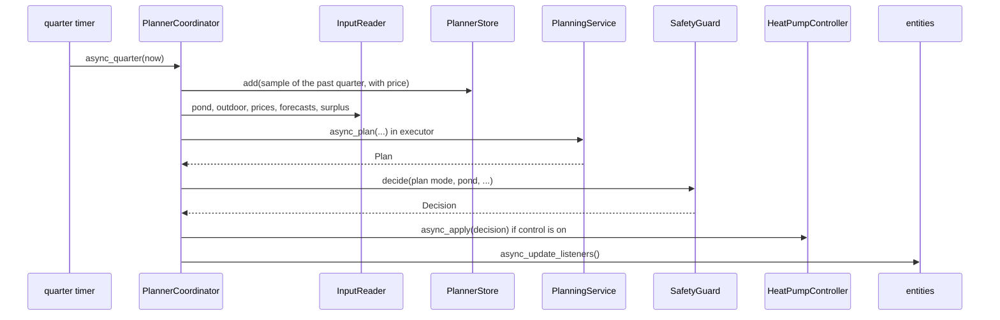

# Entities, configuration and translations

- Issue: #5
- Status: **approved** (2026-11-17)
- Date: 2026-11-17

## 1. Purpose

Connect the core (#2, #3, #4, #8) to Home Assistant:
- configure everything in the UI;
- run the planning cycle, the nightly learning and the COP bookkeeping;
- make the plan, the model and the COP visible as entities.

## 2. Configuration

### 2.1 Config flow (links to other entities)

Four steps. Only step 1 is required; the other steps can be skipped and added later through
*Reconfigure*.

| Step | Field | Required | Selector | Without it |
|---|---|---|---|---|
| 1 Pond and heat pump | Name | yes | text | – |
| | Pond temperature | yes | sensor, device class temperature | – |
| | Heat pump | yes | climate | – |
| | Heat pump power | yes | sensor, device class power | – |
| | Water inlet temperature | no | sensor, temperature | setpoint from the rounded pond temperature (#4) |
| | Outdoor temperature | yes | sensor, temperature | – |
| 2 Prices and weather | Price sensor | no | sensor | no prices: the plan minimises energy; reason `no_prices` |
| | Price forecast sensor | no | sensor | horizon ends at the last known price |
| | Weather | no | weather | current outdoor temperature for the whole horizon |
| 3 Solar | Surplus sensor + type (`pv_power`, `grid_export`, `grid_net`) | no | sensor + select | every quarter at the purchase price |
| | Solar forecast sensor | no | sensor | the surplus is only used for the current quarter |
| 4 COP | Water outlet temperature | no | sensor, temperature | no flow method (method 1) |
| | Energy sensor | no | sensor, device class energy | the power sensor is integrated |
| | Air inlet temperature | no | sensor, temperature | outdoor sensor used for the COP breakdown |

- **Price-sensor check.** The flow parses the price sensor's attributes (#3) and refuses a sensor without a
  recognised price list.
- **Unique ID.** The unique ID is the climate entity, so the same heat pump cannot be added twice.

### 2.2 Options (tuning)

| Option | Default | Range | Effect |
|---|---|---|---|
| Price multiplier / addition | 1 / 0 | | effective price = price × multiplier + addition (e.g. EPEX → all-in: 1.21 / 0.136) |
| Price forecast multiplier / addition | same as price | | the same for the forecast sensor |
| Feed-in multiplier / addition | 1 / 0 | | value of own solar power, applied to the price sensor's price; default = net metering |
| Base load (W) | 300 | 0–5000 | household use subtracted from PV power |
| Start penalty (€) | 0.05 | 0–1 | fewer starts at a slightly higher cost |
| Margin inside the band (K) | 0.07 | 0–0.2 | room for prediction errors |
| Allow high mode | on | | off: the planner never uses high, except safety rule 2 falls back to low |
| Expensive-quarter surcharge | auto | auto or 0–2 €/kWh | auto = tuned nightly (#3) |
| Horizon (h) | 36 | 6–48 | |
| Setpoint offsets off / low / high (K) | −2 / 0 / +1 | −5 … +5 | see #4 |
| Power thresholds off/low, low/high (W) | 150 / 650 | | mode detection for learning and COP |
| COP window (days) | 14 | 7–42 | |
| COP run threshold (W), settle time (min) | 100 / 20 | | flow method |

## 3. Entities

All entities belong to one device (the planner), with `has_entity_name` and translation keys.

### 3.1 Settings (restored after a restart)

| Entity | Type | Range / options | Category |
|---|---|---|---|
| Target temperature | number | 5–32 °C, step 0.1 | – |
| Band | number | 0.1–1.0 K, step 0.05, default 0.25 | – |
| Pond volume | number | 1–500 m³, step 0.25 | config |
| Flow through the heat pump | number | 0.5–20 m³/h, step 0.25 | config |
| Control | switch | default off (dry run) | – |
| Insulation cover | switch | default off | – |
| COP method | select | flow, pond, average (default) | config |
| Re-learn now | button | – | diagnostic |

### 3.2 Plan

| Entity | State | Attributes |
|---|---|---|
| Mode | enum: off, low, high | `reason` (#4), `plan_mode`, `would_set`, `control`, `plan` (per quarter: start, mode, temp, price; not recorded), `horizon_end` |
| Next start / next stop | timestamp | – |
| Planned energy, next 24 h | kWh | – |
| Planned cost, next 24 h | € | `expensive_share`, `starts` |
| Predicted pond temperature in 4 h | °C | – |

### 3.3 COP and pond (#8)

| Entity | State | Attributes |
|---|---|---|
| COP | per the COP method | `by_outdoor`, `by_power`, `hours`, `window_days`, `method` |
| COP flow method / COP pond method | each method | as above; pond: `loss_a_w`, `loss_b_w_per_k` |
| Heat loss | W/K | `loss_b_w_per_k`, `loss_a_w`, `cover` |
| Thermal power | W (power, measurement) | `flow_mean_w`, `mode` |

### 3.4 Diagnostics

| Entity | State | Attributes |
|---|---|---|
| Cooling coefficient | 1/h | `k_open`, `k_cover`, last `FitReport` |
| Heating rate low / high | K/h | gain, power |
| Prediction error (4 h) | K | number of checked predictions |
| Model status | timestamp of the last learning | all `FitReport`s, `model_check` (#8), `samples` |
| Expensive-quarter surcharge | €/kWh | `mode` (auto/manual), candidate costs |

**Download diagnostics** returns the options, the model parameters, the last reports, a plan summary and
sample counts. It contains no entity states of other integrations beyond what is listed.

## 4. Runtime

### 4.1 Components

| Component | Responsibility | Pattern |
|---|---|---|
| `PlannerCoordinator` | owns the state of one entry and runs the cycles; entities observe it | coordinator / Observer |
| `InputReader` | reads states and attributes of the linked entities into core inputs (prices, forecasts, surplus) | Adapter |
| `PlanningService` | builds a `PlanRequest`, calls the `Planner` in the executor | Facade over the core |
| `LearningService` | nightly `Learner` run, surcharge tuning, loss fit | Facade |
| `HeatPumpController` | applies decisions (#4) | – |
| `PlannerStore` | samples, COP buckets, parameters, settings (#2) | Repository |

### 4.2 Timers and listeners

| Trigger | Action |
|---|---|
| Every quarter (:00:05, :15:05, …) | close the sample of the past quarter, record the prediction error, plan, decide, apply, update entities |
| Every full hour | close the COP bucket |
| 03:30 local | learn (`Learner`), fit the loss, tune the surcharge (executor, ~1 min), save |
| State change of power, inlet, outlet, energy, outdoor | `PowerIntegrator` and `FlowAccumulator` updates; inlet change → re-apply (#4) |
| Change of target, band, cover, control, options | replan at once (debounced 2 s) |
| Home Assistant start | load the store, seed from the recorder if needed, plan once inputs are available |

### 4.3 Diagrams

## 5. Translations

`strings.json` with config, options, entity names, enum states (mode, reason, COP method, surplus type),
repair issue and errors. `translations/en.json` and `translations/nl.json`.

## 6. Tests

- **Core logic:** stays in the pure core tests. The HA layer is kept thin: `InputReader` conversions are
  pure functions tested with fixture states.
- **CI:** hassfest validates manifest, strings and translations.
- **HA test harness:** `pytest-homeassistant-custom-component` needs Python 3.13. CI gets a separate job
  that runs config-flow and coordinator tests with it. Locally they are skipped when Home Assistant is not
  installed.

## 7. Out of scope

A custom Lovelace card (an ApexCharts example comes with the documentation, #6), more than one heat pump
per entry, energy dashboard integration.
