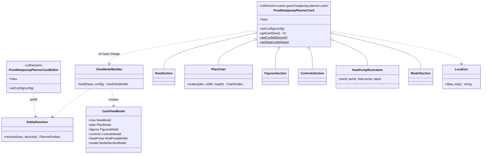
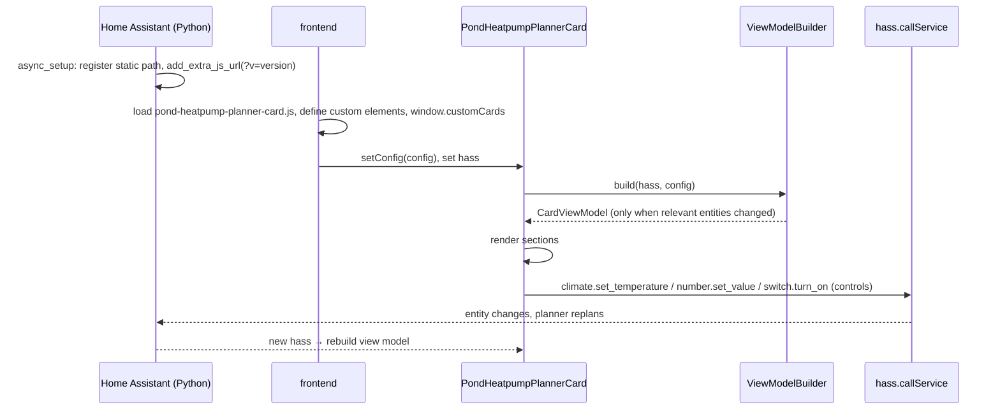

# Lovelace card

- Issue: #10
- Status: **draft**; depends on #12 (climate entity for the target)
- Date: 2026-11-17

## 1. Purpose

One card that shows the planner at a glance and lets the user adjust it. It includes an illustration of the
heat pump with live values and animations. The card ships inside the integration: installing or updating
through HACS is enough, with no separate plugin and no manual dashboard resource.

## 2. Delivery

### 2.1 Bundled with the integration

```
frontend/                      TypeScript sources (not loaded by Home Assistant)
  src/…
  package.json, tsconfig.json, build.mjs
custom_components/pond_heatpump_price_planner/
  frontend/pond-heatpump-planner-card.js   built bundle, committed
```

- **Serving.** `async_setup` (integration level, once) registers the bundle as a static path:
  `/pond_heatpump_price_planner/pond-heatpump-planner-card.js`, with cache headers.
- **Registration.** `frontend.add_extra_js_url` loads it for all dashboards. The URL carries the integration
  version (`?v=0.2.0`), so browsers load the new card after an update. This works for storage and YAML
  dashboards and needs no Lovelace resource.
- **Manifest.** Gets `"dependencies": ["frontend", "http"]`. The integration keeps `config_entry_only`
  configuration.
- **Self-contained.** The bundle is built with esbuild from TypeScript and contains Lit. No CDN, no network
  requests at runtime. Size budget: < 120 kB minified.

### 2.2 Card type and picker

- **Type:** `custom:pond-heatpump-planner-card`.
- **Picker:** registered in `window.customCards` with a name, a description and `preview: true`, so it
  appears in the card picker with a live preview.
- **Stub config:** `getStubConfig()` picks the first planner device. `getConfigElement()` returns the visual
  editor.

## 3. Data

The card reads only entities of one planner device. The device is chosen in the editor (a device selector
filtered on the integration). The card finds its entities in `hass.entities` by device and translation key
(`mode`, `target`, `band`, `cop`, …), so it works regardless of entity IDs and UI language.

| Section | Source |
|---|---|
| Now | the pond climate entity of #12 (current and target temperature, heating or idle), `mode` (state, `reason`, `measured_mode`, `would_set`, `control`), `band`, `next_start`, `next_stop` |
| Plan chart | `mode.plan` (per quarter: start, mode, temp, price; §6 adds `surplus` and `known`), target from the climate entity, `band` |
| Key figures | `planned_energy`, `planned_cost` (`expensive_share`, `starts`), `cop` (`method`), `heat_loss`, `thermal_power` |
| Controls | target through the climate entity (`climate.set_temperature`), `band` (number), `insulation_cover`, `control` (switch) |
| Model (collapsible) | `cooling_coefficient`, `heating_rate_low/high`, `prediction_error`, `model_status`, `cop.by_outdoor` |
| Heat pump illustration | entities chosen in the editor (§5), prefilled from the planner's links |

Controls call `climate.set_temperature`, `number.set_value` and `switch.turn_on/off` on the existing entities. The card has no logic of
its own, so the integration stays the single source of truth.

## 4. Layout

```
┌──────────────────────────────────────────────────────────┐
│ Pond  14.62 °C  ▸ target 14.5 ± 0.25     [LOW · plan]    │  now
│ next stop 03:15 · next start 11:00 · controlling ●       │
├──────────────────────────────────────────────────────────┤
│  temperature + band ─────  price (step line)      │now   │  plan chart (24/36 h)
│  ▇▇▇░░░▇▇▇▇▇▇░░░░░░▇▇▇  mode bars (off/low/high)  │      │
├──────────────────────────────────────────────────────────┤
│ € 2.31 / 24 h · 7.1 kWh · 6 % expensive · COP 5.4 (avg)  │  key figures
│ heat loss 295 W/K · thermal power 2.85 kW                │
├──────────────────────────────────────────────────────────┤
│        [heat pump illustration with live values]         │  §5
├──────────────────────────────────────────────────────────┤
│ target [14.5] band [0.25]  cover ○  control ●            │  controls
├──────────────────────────────────────────────────────────┤
│ ▸ Model                                                   │  collapsible
└──────────────────────────────────────────────────────────┘
```

- **Responsive:** the card is one column at phone width. From a wide dashboard column the key figures and
  controls sit side by side.
- **Sections:** each one can be hidden in the editor.
- **Unconfigured parts:** a section whose entities are unavailable is hidden (e.g. COP without a pond
  volume), rather than showing errors.

## 5. Heat pump illustration

An inline SVG of the installation as a simple process diagram:
- the pond, drawn as a tub of water, with the pond temperature shown in the water;
- a supply pipe from the pond through a **circulation pump** to the heat pump's water inlet;
- the air-to-water heat pump: housing, fan, compressor and **heat exchanger** (condenser): the water from the
  inlet flows through the heat exchanger, where the refrigerant coil heats it, and leaves through the outlet;
- a return pipe from the heat pump's water outlet back to the pond.

```
        air in ──►  ┌──────────────────────┐  ──► air out
                    │  ( fan )   [comp]    │
                    │   mode · electrical  │
                    │          · thermal   │
                    │   ┌─[ /\/\/\ ]─┐   │  heat exchanger
                    └───┼──── 17 °C ───┼───┘
     ┌──── P ───────────┘ water in     └ water out ──┐
     │  pump · running · 2450 rpm                    │
     │ supply                                 return │
  ┌──┴────────────────────────────────────────────┴──┐
  │  ~~~~~~~~~~~~~~~  pond  14.6 °C  ~~~~~~~~~~~~~~~  │
  └───────────────────────────────────────────────────┘
```

- **Pump symbol:** the standard installation symbol for a centrifugal pump (a circle with a triangle pointing
  in the flow direction, as in ISO 14617 / P&ID drawings), not a picture of a pump.
- **Flow direction:** arrows on the pipes show it: pond → pump → water inlet, water outlet → pond.

| Element | Shown | Entity (editor) |
|---|---|---|
| Pond | water temperature in the tub | the planner's thermostat (`current_temperature`) |
| Water in / water out | value at the supply and return pipes, below the housing | `water_in`, `water_out` (temperature) |
| Heat exchanger | temperature below the heat exchanger; the coil glows while the compressor runs | `heat_exchanger` (temperature, e.g. the condenser temperature) |
| Air in / air out | value at the air flow arrows | `air_in`, `air_out` (temperature) |
| Electrical and thermal power | both on the housing, one under the other | `power`, the planner's `thermal_power` |
| Mode | label (off/low/high) on the housing | the planner's `mode` |
| **Fan animation** | the fan turns while the entity is on | `fan` (boolean, e.g. "fan active") |
| **Water flow animation** | dashes move along the supply and return pipes in the flow direction while the entity is on | `flow` (boolean, e.g. "circulation active") |
| **Pump state** | the pump symbol is **green** while running (`flow` on), **red** on a fault (`pump_fault` on, takes precedence), **grey** when off; the state is also written under the pump (running / fault / off) | `flow`, `pump_fault` (boolean) |
| Pump speed | value under the pump in rpm (the unit of the sensor is shown as is) | `pump_speed` (sensor, rpm) |
| Compressor | glows while the entity is on | `compressor` (boolean) |

**Defaults.** The editor prefills `water_in`, `water_out`, `air_in` and `power` from the planner's links. The
others are left for the user. On the reference installation:
- `air_out`: `sensor.w_eau_heatpump_air_outlet_temperature`;
- `heat_exchanger`: `sensor.w_eau_heatpump_condensor_temperature`;
- `fan`: `binary_sensor.w_eau_heatpump_fan_active`;
- `flow`: `binary_sensor.w_eau_heatpump_circulation_active`;
- `compressor`: `binary_sensor.w_eau_heatpump_compressor_active`;
- `pump_speed`: the speed sensor (rpm) of the pump that feeds the heat pump;
- `pump_fault`: a fault sensor of that pump, if there is one.

**Animations.**
- They are CSS animations: a rotating fan group, `stroke-dashoffset` along the pipe paths, a pulsing glow.
  They run only while the boolean entity is `on`.
- An entity that is off, unavailable or not configured gives a still drawing.
- `prefers-reduced-motion: reduce` stops all animations; the on/off state then shows as a colour and a
  label.
- The flow speed is fixed. It does not suggest a measured flow rate.

Drawings with the reference values and the animations:
- the whole illustration: [`assets/2026-11-17-heatpump-illustration.svg`](assets/2026-11-17-heatpump-illustration.svg);
- the three pump states: [`assets/2026-11-17-pump-states.svg`](assets/2026-11-17-pump-states.svg).

**Missing values** are left out of the drawing, with no empty labels. The drawing scales with the card
width; the values stay readable at phone width (the labels move inside the drawing's bounding box rather than
shrinking below 12 px).

## 6. Small additions to the integration

The chart needs two things the integration does not publish yet:

| Addition | Where | Why |
|---|---|---|
| `known` per quarter in `plan` (true where the price is known, false where it comes from the forecast) | `sensor.mode` attribute | mark the known-prices boundary in the chart |
| `surplus` per quarter in `plan` (kW, only when solar is configured) | `sensor.mode` attribute | mark solar quarters |

These are attributes of an existing sensor. They are already excluded from the recorder, so the database does
not grow.

## 7. Look and accessibility

- **Theme:** Home Assistant theme variables throughout (text, card background, divider, primary,
  error/warning colours), so light and dark themes work.
- **Mode colours:** off is grey with a hatch pattern, low is blue, high is orange. In the chart and the
  labels the mode is also written, so colour is never the only cue.
- **Chart:** the temperature axis is on the left, the price axis on the right. The band is a shaded area and
  the target a dashed line. The expensive quarters (top 25 % per day) are a light background.
- **Accessibility:**
  - controls are focusable and have labels;
  - the chart has a text summary for screen readers ("low 11:00–03:15, off 03:15–11:00, …").
- **Language:** English and Dutch, from `hass.locale.language`; other languages fall back to English.

## 8. Architecture

### 8.1 Components



- **Pure data layer.** `ViewModelBuilder`, `EntityResolver`, `Localizer` and the chart scaling are plain
  TypeScript without DOM. They are unit-tested.
- **Presentational sections.** The section elements only render their part of the view model and emit
  events for controls (single responsibility).
- **Dependency inversion.** The card depends on the view model, not on entity IDs.

### 8.2 Loading and updating



**Re-render rule.** The card re-renders only when one of its entities changes, compared by `last_updated`.
This keeps a busy dashboard cheap.

## 9. Configuration

```yaml
type: custom:pond-heatpump-planner-card
device_id: 0123456789abcdef          # the planner device (editor: device picker)
hours: 36                            # 24 or 36
sections: [now, plan, figures, heat_pump, controls, model]   # order and visibility
heat_pump:                           # all optional; prefilled from the planner
  water_in: sensor.w_eau_heatpump_water_inlet_temperature
  water_out: sensor.w_eau_heatpump_water_outlet_temperature
  air_in: sensor.w_eau_heatpump_air_inlet_temperature
  air_out: sensor.w_eau_heatpump_air_outlet_temperature
  heat_exchanger: sensor.w_eau_heatpump_condensor_temperature
  power: sensor.warmtepomp_vijver_power
  fan: binary_sensor.w_eau_heatpump_fan_active
  flow: binary_sensor.w_eau_heatpump_circulation_active
  compressor: binary_sensor.w_eau_heatpump_compressor_active
  pump_speed: sensor.heat_pump_circulation_pump_speed
  pump_fault: binary_sensor.circulation_pump_fault
```

The editor uses Home Assistant's form elements (`ha-form`) with a device selector, a number selector, a
section multi-select and entity selectors for the heat pump.

## 10. Build, tests and CI

- **Tooling:**
  - Node 22, TypeScript, Lit 3, esbuild;
  - Vitest for unit tests;
  - permissive licences only (Lit: BSD-3-Clause).
- **Unit tests:**
  - `EntityResolver`: by device and translation key, missing entities;
  - `ViewModelBuilder`: unconfigured parts hidden, values and units;
  - chart scaling and the text summary;
  - `Localizer`: en, nl, fallback.
- **Rendering test.** One test renders the card in jsdom with a fake `hass` and checks that the sections
  appear and that the animations follow the boolean entities (CSS class on/off).
- **CI job `card`:**
  - `npm ci`, lint, type check and tests;
  - `npm run build`, then `git diff --exit-code` on the committed bundle, so the bundle always matches the
    sources;
  - a size check.
- **Python tests:** a Home Assistant test checks that the static path and the extra JS URL are registered.

## 11. Documentation

- **`docs/card.md`:** adding the card, the editor, the YAML options, which entities feed the illustration,
  and screenshots in light and dark (from the test installation with neutral names).
- **`docs/architecture.md`:** a section with the diagrams of §8.
- **Pointers:** the README and `docs/dashboard.md` point to the card.

## 12. Out of scope

A separate HACS plugin; editing the integration's options from the card; history beyond the planning horizon
(use Home Assistant's history and statistics cards); a configurable flow speed; drawings of other heat pump
types.
