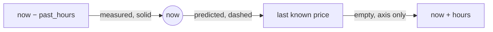
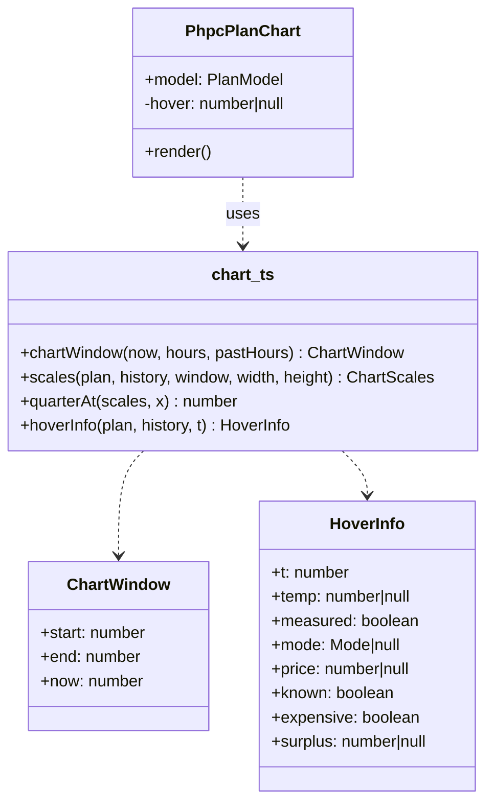

# Plan chart: fixed span, measured temperature, hairline with tooltip

- Issue: #22
- Status: draft
- Date: 2026-11-18

## 1. Purpose

The plan chart is now as long as the plan, and the plan is only as long as the known prices. Before the
day-ahead prices are published (about 13:00) that is less than 15 hours. This makes the chart change scale
during the day. The chart also shows only the prediction, so you cannot see how well it matched, and you
cannot read exact values.

This design gives the chart:
1. a fixed time span;
2. the measured pond temperature up to now;
3. a hairline with a tooltip.

## 2. Time window

| Card option | Default | Range | Meaning |
|---|---|---|---|
| `hours` | 36 | 6–48 | hours after now (existing option, now always the full width) |
| `past_hours` | 6 | 0–24 | hours before now with the measured temperature (new) |

- Window: `start = now − past_hours`, `end = now + hours`, both rounded down to the quarter.
- The x scale always uses this window. The plan fills it from its first quarter up to its last one; the rest
  stays empty. The axis, the grid lines and the date labels (#21) cover the whole window.
- The temperature scale covers the band, the plan and the measured values inside the window. The price scale
  covers the plan's prices only.
- "Now" stays a red vertical line. With `past_hours: 0` the chart starts at now, as in 0.4.0, but keeps its
  fixed span.

## 3. Measured and predicted temperature

| Part | Source | Line |
|---|---|---|
| Measured, from `start` to now | `pond_history` (mode sensor, #21), quarter values; the current pond temperature as the last point | solid, `--phpc-pond-color` |
| Predicted, from now | `plan[].temp` | dashed, same colour; starts at the current measured value so the two lines join |

- Legend: "pond temperature (measured)" (solid) and "pond temperature (predicted)" (dashed).
- `pond_history` covers 24 h. With `past_hours` above 24, the measured line starts later.
- Gaps of more than 30 minutes in the history break the measured line instead of drawing a straight
  segment across them.

## 4. Hairline and tooltip

- **Pointer.** `pointermove` over the chart gives the time under the pointer. That time is rounded to its
  quarter and clamped to the window. `pointerleave` hides the hairline. On touch screens, a tap or a drag
  shows it, and a tap outside the chart hides it. `touch-action: pan-y` keeps vertical scrolling of the
  page working.
- **Keyboard.** The chart gets `tabindex="0"`. ← and → move one quarter, Home and End jump to the first and
  last quarter, and Escape hides the hairline. The tooltip text is also the `aria-live` text.
- **Drawing.** The hairline, a dot on the temperature line and the tooltip all come from the same quarter.
  The tooltip is an HTML element over the SVG (positioned in % of the width). It sits to the right of the
  hairline, or to the left on the right half, so it stays inside the card.
- **Contents:**

| Line | Example | When |
|---|---|---|
| day and time | Thu 19 Nov 14:15 | always (local time, card language) |
| pond temperature | 14.62 °C measured / 14.58 °C predicted | when known |
| mode | low | plan quarters |
| price | € 0.244 /kWh (forecast) | plan quarters |
| expensive quarter | expensive quarter | when it is one |
| solar surplus | solar 0.4 kW | when > 0 |

Quarters without information (after the plan, or before the history) show only the time.

## 5. Structure

The chart stays a pure view: geometry in `chart.ts` (no DOM), state in a small element.

- **`PhpcPlanChart`** is a new Lit element (`phpc-plan-chart`), like `phpc-gauge`. It holds only the hover
  state, so a pointer move redraws the chart and not the whole card.
- **`PlanModel`** gets `history` (from the gauge model) and `window`.
- **`card.ts`** renders `<phpc-plan-chart>` instead of calling `planChart()`.
- **Editor:** a number field for `past_hours`.

## 6. Tests

- `chartWindow`: span = `past_hours + hours`, rounded to the quarter; a plan shorter than the window keeps
  the full x range.
- `hoverInfo`: a past quarter gives the measured value and no mode; a plan quarter gives the predicted
  temperature, mode, price and forecast flag; a quarter after the plan gives only the time.
- `quarterAt`: the pointer x maps to the right quarter and is clamped to the window.
- Card: there is a solid measured path and a dashed predicted path; a `pointermove` shows the hairline and
  the tooltip with the expected text; `pointerleave` hides them; the arrow keys move the hairline.
- Docs: `card.md` (options, hover), screenshots (one with the tooltip visible), architecture UML, changelog.

## 7. Open questions

- Is `past_hours: 6` a good default?
