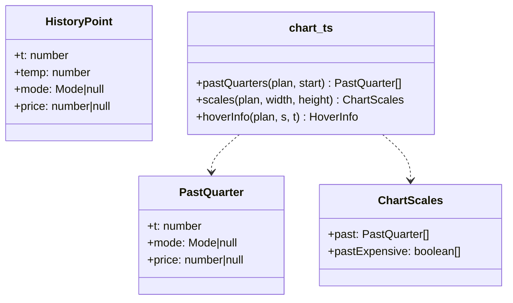

# Plan chart: measured modes and prices before now

- Issue: #34
- Status: **approved** (2026-11-20)
- Date: 2026-11-20

## 1. Purpose

Left of now the plan chart shows only the measured pond temperature. The mode bars, the price line and the
expensive quarters start at now, so you cannot see when the heat pump actually ran, when it ran on high, or
what the prices were. This design fills in the history part of the chart with the measured mode and the
price of each past quarter.

## 2. Data

The store already holds a sample per past quarter with the mean heat pump power and the effective purchase
price (`Sample.power`, `Sample.price`). Nothing new is stored.

The items of the `pond_history` attribute of the mode sensor get two optional fields:

| Field | Source | Omitted when |
|---|---|---|
| `mode` | `ModeClassifier.mode(power)`: off/low/high, the same thresholds as `measured_mode` | the power is unknown |
| `price` | `Sample.price` (€/kWh, rounded to 4 decimals, same transform as the plan prices) | the price is unknown |

```json
{"time": "2026-11-20T10:15:00+00:00", "temp": 14.42, "mode": "low", "price": 0.2431}
```

`time` stays the end of the quarter (the pond temperature is measured then); the quarter itself starts
15 minutes earlier. The attribute is already excluded from the recorder. The 48 h window stays.

## 3. Chart

- **Past quarters** are the history items whose quarter starts before the first plan quarter and inside the
  chart window.
- **Mode bars:** drawn for past quarters with a mode, with the same colours as the plan, at a lower opacity
  so the measured part stays distinguishable from the plan. No bar when the mode is unknown.
- **Price line:** one step line from the first past quarter with a price through the plan. A past quarter
  without a price breaks the line.
- **Price scale:** includes the past prices in the window.
- **Expensive quarters:** the same rule as now (above the 75th percentile of a 24 h block), on the combined
  timeline of past and plan quarters. The blocks stay anchored on the start of the plan and continue back in
  steps of 24 h, so the marking of the plan quarters does not change.
- **Tooltip** for a past quarter: measured temperature, mode, price and "expensive quarter" when they are
  known.
- **Legend** and the screen-reader summary are unchanged (the summary describes the plan).

## 4. Structure



- **Integration:** `_pond_history` in `sensor.py` adds `mode` (via the coordinator's `ModeClassifier`) and
  `price`.
- **`viewmodel.ts`:** `HistoryPoint` gets optional `mode` and `price`; the parser accepts only known modes
  and finite prices.
- **`chart.ts`:** `pastQuarters()` turns history points into quarters (start = time − 15 min);
  `scales()` adds `past` and `pastExpensive` and widens the price range; `hoverInfo()` fills mode, price and
  expensive for past quarters.
- **`plan-chart.ts`:** draws past bars (class `past`), past expensive bands and the combined price line.

## 5. Tests

- Python: `pond_history` items carry `mode` from the power and `price`; both are omitted when unknown.
- `pastQuarters`: only quarters before the plan and inside the window; quarter start is time − 15 min.
- `scales`: the price range includes past prices; the expensive marking of plan quarters is unchanged;
  past quarters are marked with the block before the plan.
- `hoverInfo`: a past quarter gives measured temperature, mode, price and expensive.
- Card: past bars with class `past` are drawn left of now; the price path starts at the first past quarter.
- Docs: `card.md`, `entities.md` (attribute), screenshot, architecture UML, changelog.

## 6. Out of scope

- The planned mode of past quarters (only the measured mode is shown).
- Solar surplus and forecast flags for past quarters.
- Storing more than the existing samples or a longer history.

## 7. Open questions

None.
