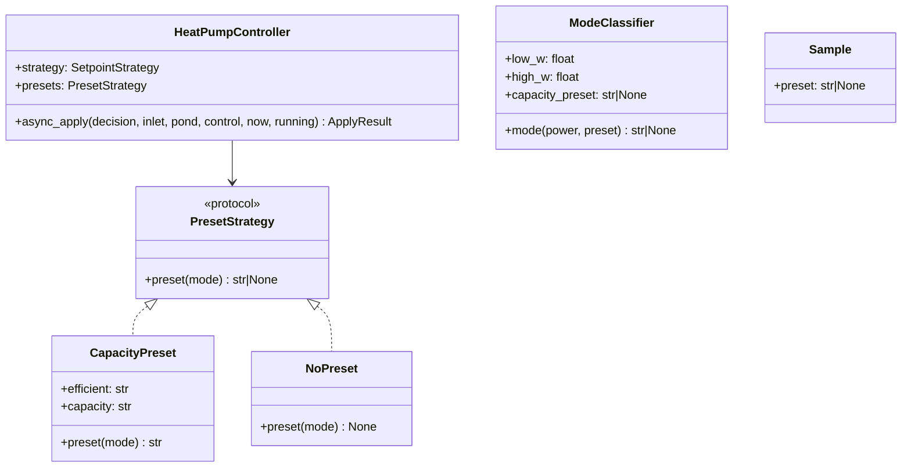
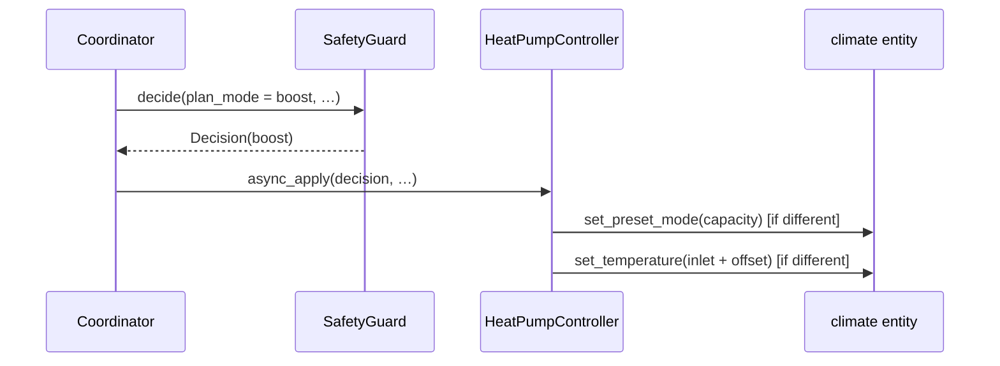

# Capacity preset: a boost mode for cold weather

- Issue: #37
- Status: **approved** (2026-11-24)
- Date: 2026-11-24

## 1. Purpose

Some heat pumps have an efficient preset and a capacity preset. A W'eau has `quiet_heat` and `quick_heat`.
On the efficient preset, high may not be enough to keep the pond in its band in cold weather. On the
capacity preset the heat pump draws more power, but its COP is lower.

This design adds a fourth mode, **boost**: the capacity preset with the setpoint of high. The planner
chooses boost per quarter like the other modes. The integration switches the preset itself.

### Measurements (W'eau, 24-11-2026, pond 14 °C, air −4 °C)

| Preset | Setpoint − inlet | Power |
|---|---|---|
| `quiet_heat` | +1 | ~ 950 W |
| `quick_heat` | +1 | ~ 1020–1180 W (lower after a defrost, sags before one) |
| `quick_heat` | +2 | ~ 1185 W, the same as +1 |
| `quick_heat` | +3 | ~ 1015 W, the same as +1 after the same defrost |

On `quiet_heat`, +2 also gave no more than +1 (895 against 940 W, October and November). So the preset is
the only capacity knob, and boost uses the same setpoint as high.

## 2. Decisions (from the issue)

| Question | Decision |
|---|---|
| Trigger | Prediction: the plan picks boost when it predicts that the pond would otherwise fall below the band. |
| Switching back | As soon as the model says the efficient preset is enough again. |
| Place in the plan | A planner mode (boost), chosen per quarter with its own power, heating rate and cost. A fifth mode (capacity preset with setpoint +0) may follow; see §9. |
| Switch | None. Boost is on when both presets are set in the options; the existing *control the heat pump* switch also covers the preset. |

The prediction and the switching back follow from the planner itself:
- The dynamic program picks boost only in quarters where it lowers the total cost, including the band
  penalty.
- Boost costs more per kelvin than high, so the planner uses it when high cannot reach the band in time. It
  also uses it when the price difference between quarters outweighs the lower COP. That is the same
  trade-off it already makes between low and high.
- A penalty per preset change (§4) keeps it from flipping between high and boost.

## 3. Modes

| Mode | Preset | Setpoint | Available |
|---|---|---|---|
| off | efficient | off offset | always |
| low | efficient | low offset | always |
| high | efficient | high offset | unless high is disabled |
| boost | capacity | boost offset (default: the high offset) | when both presets are set and high is allowed |

`MODES` becomes `("off", "low", "high", "boost")`. Code that loops over `MODES` works unchanged.
Code that names modes is listed in §6.

Off and low always use the efficient preset. The preset changes only when entering or leaving boost.

## 4. Planner

- **Mode set:** `PlanRequest.allow_boost` (false without presets) removes boost from the mode set, like
  `allow_high`.
- **Preset change penalty:** every transition between boost and any other running mode costs
  `preset_penalty`. The default is the start penalty, €0.05. This works like the start penalty: the
  previous mode is already part of the state, so nothing else changes.
- **Start from off:** a start straight into boost is allowed. The start factor applies as for the other modes.
- **Horizon heat value:** unchanged. It is still based on low.
- **Summary:** energy, cost and expensive share count boost as running; `next_start` and `next_stop` are
  unchanged.

## 5. Model and learning

### Samples record the preset

The measured power alone cannot tell boost from high: after a defrost, quick heat draws about 1015 W and
quiet heat about 950 W. So every quarter sample stores the preset:

- **New field:** `Sample.preset: str | None`, the preset of the climate entity at the end of the quarter.
  This works like `cover`. In storage it is a seventh list element, and older rows read as `None`.
- **Seeding:** samples from the recorder get the preset from the `preset_mode` attribute history of the
  climate entity.
- **Backfill:** on the first start after the upgrade, stored samples with `preset = None` are filled from
  the recorder as far back as it goes (10 days by default). This separates the quick-heat quarters since
  24-11 08:13.

### Mode of a sample

`ModeClassifier.mode(power, preset)` works as follows:

| Condition | Mode |
|---|---|
| power below the low threshold | off |
| preset is the capacity preset, and power at or above the high threshold | boost |
| otherwise | low or high by power, as now |

A sample with an unknown preset counts as the efficient preset, as now. The measured mode and the
`pond_history` items can therefore be `boost`.

### Learning

- **Thermal model:** `ModelParams.power` and `gain` get a `boost` key. The defaults are
  `power["boost"] = 1.10` kW and `gain["boost"] = gain["high"]` until boost has been learned.
- **`Hour`:** gets `p_boost` and `w_boost`.
- **`SlowFit`:** fits `gain_boost` when there are at least `min_mode_hours` hours with boost, like
  high. Otherwise it subtracts the known boost heat. The boost power is the median of the boost samples.
- **`CoolingFit`:** also subtracts `gain["boost"] * w_boost`.
- **Result:** the high parameters no longer contain quick-heat data, and boost gets its own parameters.
- **Stored parameters:** a missing `boost` key gets its default.

## 6. Control

### Preset

`HeatPumpController.async_apply` first sets the preset of the decided mode, then the setpoint:
- **When it sends:** only when the preset differs from the current one, and only with control on.
  In a dry run it only reports what it would do.
- **Service:** `climate.set_preset_mode`.
- **Strategy:** a new `PresetStrategy`, separate from `SetpointStrategy`, maps a mode to a preset.
  `CapacityPreset(efficient, capacity)` returns the capacity preset for boost and the efficient preset for
  the other modes. `NoPreset` never changes the preset and is used when the options are empty.
- **When control is turned off:** the controller sets the efficient preset once, so the heat pump does
  not stay on quick heat.

### Other modes

- **Setpoint:** `DEFAULT_OFFSETS` gets `boost` (default +1). `HEATING` gets boost. The start offset also
  applies to boost.
- **Safety:**
  - `MODE_RANK` gets boost at rank 3;
  - far below the band: boost when available, otherwise high;
  - below the band: the plan's mode if it is at least low;
  - other rules unchanged.
- **Mismatch check:** unchanged, because it only compares off with running.
- **Manual preset change:** with presets set, the controller corrects it at the next quarter, as it does
  with the setpoint today. Without presets, the integration never touches the preset. That is how the
  integration works today.

## 7. Options, entities and card

### Options

Two optional options, in the *heat pump* step of the options flow:
- **Efficient preset:** chosen from the climate entity's `preset_modes`.
- **Capacity preset:** the same list.

Boost is off unless both are set and differ. Translations come in English and Dutch.

### Entities

- **Mode sensor:** the enum options get `boost`.
- **Measured mode:** the `measured_mode` attribute can be `boost`.
- **New attribute:** `preset` on the mode sensor, with the preset the planner wants.
- **New model sensor:** *Heating rate boost*, with the attributes `gain` and `power_kw`, like low and high.
  It only exists when boost is configured.
- **Diagnostics:** the plan string uses `B` for boost.

### Card

- **Modes:** `boost` is added to the frontend `MODES` and `Mode`.
- **Plan chart:** the bars use their own colour (red), in the plan and in the past part, with a legend
  entry and translations.
- **Hover:** the tooltip shows the mode name.
- **Drawing:** boost counts as running.
- **Figures:** unchanged; the model section shows the boost heating rate when it exists.

### COP

The COP per mode (`by_power`) stays low and high. Boost hours count as high in the COP bins. A separate
boost COP is out of scope (§10).

## 8. Structure

## 9. Possible fifth mode

A fifth mode would combine the capacity preset with setpoint +0. It is useful only if it gives more heat
than high at a similar or better COP. That has not been measured.

Later, when it is less cold (#38), one test on the W'eau: about 30 minutes of `quick_heat` with setpoint +0,
outside a defrost, compared with `quiet_heat` +1 and +0. If it is useful, it becomes one more row in §3
(preset, offset). The mode list, the classifier and the card already handle any number of modes, so the
change stays small. The classifier would then need a power threshold between the two quick-heat levels.

## 10. Tests

- **Planner:**
  - without `allow_boost`, the plan never contains boost;
  - with a cold forecast that high cannot follow, the plan picks boost and stays in the band;
  - with a mild forecast, there is no boost;
  - the preset penalty prevents flipping between high and boost.
- **Classifier:** boost only with the capacity preset and power at or above the high threshold; an unknown
  preset counts as efficient.
- **Samples:** a stored six-element row reads with `preset = None`; seeding takes the preset from the
  attribute history; the backfill fills only `None` presets.
- **Learning:**
  - `gain_boost` and `power["boost"]` are learned from boost hours;
  - high is no longer influenced by boost hours;
  - CoolingFit subtracts boost.
- **Control:**
  - the preset is sent only when it changes, and never in a dry run;
  - turning control off restores the efficient preset;
  - `NoPreset` never calls the service.
- **Safety:** far below the band gives boost when it is available.
- **Card:** boost bars and their legend entry; boost counts as running; the mode parser accepts boost.
- **Docs:**
  - `configuration.md` (options), `entities.md`, `card.md` and `how-it-works.md`;
  - architecture UML: classes, the control sequence, and the mode state diagram;
  - the changelog.

## 11. Out of scope

- Changing setpoint offsets for capacity: measured, no effect.
- A separate COP for boost.
- Modelling defrost cycles.
- Cooling presets.

## 12. Implementation notes

The build differs from the sections above in three small points:
- **Boost gain before learning (§5):** boost starts at 0.9 × the gain of high, not equal to it. With equal
  gains, boost would look as efficient as high before it has been learned, and the planner would use it to
  store heat in cheap quarters.
- **Options (§7):** the options flow is one form, so the preset fields are part of it. They appear only when
  the climate entity has `preset_modes`. One preset, or the same preset twice, gives the error
  `presets_incomplete`.
- **`apply_result` (§6):** this is `sent` when only the preset was sent.

## 13. Open questions

- **Fifth mode:** the setpoint +0 test from §9, tracked in #38. It does not block this design.
